<p align="center"></p>

> Shatter it across five nodes. It still answers with one truth.

**glassring** is a deterministic chaos lab for a Dynamo-style replicated key-value store, in one file with zero dependencies: consistent hashing, vector clocks, sloppy quorum, hinted handoff, and read-repair — the same architecture behind Amazon Dynamo, Riak and Cassandra, built from scratch and tested against the exact guarantee it claims.

No single node holds the truth. Every write is a shard of a larger structure, refracted across a 3-of-5 preference list, and the system has to prove it can reassemble one consistent answer out of whatever pieces survive partitions, crashes, and permanent data loss.

## What it proves

1000 seeds, N=3 replicas per key, W=2 writes, R=2 reads, 5 physical nodes, 26 faults per run:

| variant | violations | caught by |
|---|---:|---|
| correct ring | 0 / 1000 | clean |
| `clobber_siblings` overwrites instead of keeping concurrent versions | 941 / 1000 | quorum-lost-write |
| `hint_drop` stashes a hint, never replays it | 1000 / 1000 | hint-not-delivered, quorum-lost-write |
| `no_read_repair` never pushes merged versions back | 21 / 1000 | sibling-divergence |
| `quorum_off_by_one` accepts 1 ack as a full quorum | 12 / 1000 | quorum-under-replicated-ack |

The correct implementation survives every seed — every acknowledged write stays visible to a subsequent quorum read, every replica that sees the same key converges to the same version set, every hint whose target comes back alive gets delivered. All four mutants, each a real mistake in hand-rolled Dynamo-style replication, are caught. Note the spread: `clobber_siblings` is catastrophic (941/1000) because it corrupts almost every conflict; `quorum_off_by_one` only shows up when a failure strikes during the narrow window before the under-replicated write gets caught, so it takes longer to surface — exactly the kind of bug that passes code review and ships.

## The two bugs this lab found in its own reference implementation

Both real, both documented rather than hidden:

1. **Vclock identity collision.** The coordinator derived a new vector-clock counter from whatever context the caller passed in (`ctx + 1`), instead of keeping its own persistent, monotonically increasing counter. Two causally unrelated writes from the same node could get issued the *same* vclock value, and the second one would be silently discarded as "already seen." Fixed with the same lesson [stillpoint](../stillpoint) learned independently: identity has to be stable only if state survives a restart; here it needed to be a true per-node monotonic clock, never re-derived from caller-supplied context.
2. **MTTR vs. MTBF.** Early chaos settings crashed nodes faster than background anti-entropy could re-replicate data between them — not an algorithm bug, but a mismatch between failure rate and repair rate that *any* algorithm would lose data under. Fixed two ways: separated "process restart" (disk survives) from a much rarer "true data-loss wipe," and added a proper full-preference-list anti-entropy pass instead of relying only on read-repair-on-access.

## The shrinker

```
$ python glassring.py shrink hint_drop
hint_drop seed 1: minimal repro = 0 fault(s), 5 nodes, 204 ticks  (18 runs)
  violation: hint-not-delivered | hint for key 'user:1' -> node 3 was never replayed though the target is alive
```

No chaos needed at all — just one node briefly unreachable during an ordinary write, and a hint that never comes home.

## Strict vs. sloppy durability (a real, documented trade-off)

A write can reach its W=2 quorum two ways: two direct replicas, or one direct replica plus one hint stashed on a stand-in node. The first is unconditionally durable. The second is *sloppy quorum* — exactly as in the original Dynamo paper — and if that specific hint is lost before delivery (its holder suffers its own data loss first), the write's survival is no longer guaranteed. This lab tracks which kind of ack each commit got and only enforces the strict quorum-read guarantee where it actually applies, instead of quietly asserting something stronger than the architecture promises.

## Components

| Component | Role |
|---|---|
| `Ring` | Consistent hashing, virtual nodes, N-way preference list |
| `VClock` (`vdom`, `vmerge`) | Dominance, concurrency, and merge over per-actor vector clocks |
| `Node` | Local store: concurrent writes kept as siblings, never silently overwritten |
| `Coordinator` | Sloppy-quorum PUT/GET, read-repair, hinted handoff, full anti-entropy |
| checkers | quorum-lost-write, sibling-divergence, hint delivery — all against an independent ledger |
| `shrink` | ddmin over the fault schedule, then node count, then duration |
| `MUTANTS` | Four real Dynamo-style implementation bugs, injected on purpose |

## Run

```bash
python glassring.py selftest     # vclock math, determinism, 60 clean seeds, 4 mutants, shrinker
python glassring.py hunt 500     # sweep the correct ring and every mutant
python glassring.py shrink clobber_siblings
python glassring.py bench        # throughput over 20,000 ticks, 9 nodes
```

## Scope and honesty

- Replication factor N=3 has a real, information-theoretic limit: if every copy of a write is destroyed before anti-entropy can spread it further, no algorithm recovers it. The chaos schedule is tuned to stay within that tolerance for a *correct* implementation; this isn't a loophole, it's the same assumption every production Dynamo-style system makes.
- An in-flight read/write that never reaches quorum (R or W not met) is correctly treated as indeterminate and not checked.
- Passing 1000 seeds is strong evidence, not a mathematical proof.
- Simulated nodes in one process. It never touches a real network.

## Roadmap

- [ ] Merkle-tree anti-entropy (sync only the differing ranges, not the full key)
- [ ] Configurable N/W/R from the CLI
- [ ] A client-driven conflict-resolution API instead of the built-in deterministic reconciliation

MIT
